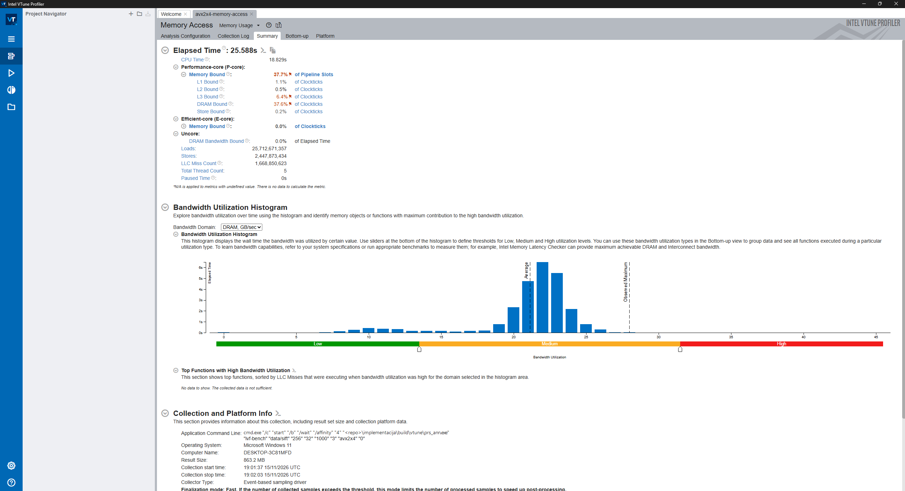

# VTune analiza i optimizacija pretrage IVF-Flat indeksa

Projekat PRS-ANN, 15. 11. 2026. Mjereno Intel VTune Profilerom 2026.6 na Intel Core i5-12500H.

## Sažetak

- **Gdje je vrijeme:** 77–84 % CPU vremena pretrage (u dva snimanja) troši jedna funkcija, kvadrat L2 udaljenosti (`l2_scalar`).
- **Čekamo li na keš i memoriju? Ne.** U početnoj verziji Memory Bound je samo ~5 %, a program čita 5,7 GB/s od ~45 GB/s koliko platforma može.
- **Šta je usko grlo:** zavisnost podataka i skalarni kod. Petlja traje tačno 2 takta po elementu, koliko jedno FP sabiranje koje čeka prethodno, a sva FP aritmetika je skalarna (FP Vector 0 %, 7 instrukcija po elementu).
- **Optimizacija:** udaljenost sa AVX2 + FMA i 4 nezavisna akumulatora. Pretraga na SIFT1M je **2,39× brža**, a kad su podaci u kešu **6,06× brža**. Rezultati su identični skalarnoj verziji (1000/1000 upita).
- **Novo usko grlo je memorija.** Na SIFT1M obje AVX2 varijante zapnu na ~13,6 GB/s, a ista funkcija iz keša čita 35 GB/s i ubrzava 6×. Četiri akumulatora iz RAM-a donose 4 %, a iz keša 19 %. VTune to potvrđuje smjerom (Memory Bound 5,5 % → 41 %), ali je finalno snimanje rađeno dok su drugi programi opterećivali memoriju, pa su ti procenti vjerovatno precijenjeni (sekcija 8). Sljedeći korak je više jezgara (OpenMP), jer donose više istovremenih zahtjeva prema memoriji.

## 1. Postavka

| | |
|---|---|
| Računar | Intel Core i5-12500H (Alder Lake: 4 P-jezgra + 8 E-jezgara, 16 niti), L2 9 MB, L3 18 MB, 16 GB RAM, Windows 11, na punjaču |
| Kompajler | GCC 13.2 (MSYS2 UCRT64), `-O3 -DNDEBUG -march=native -ffp-contract=off -g` |
| Skup | SIFT1M: 1.000.000 vektora, d = 128, liste 516 MB |
| Indeks | IVF-Flat, `nlist` = 256, napravljen jednom skalarnom verzijom i sačuvan; sva mjerenja učitavaju **isti** indeks |
| Pretraga | 1000 upita, `nprobe` = 32 (13,08 % baze, 130.769 vektora, ~64 MB po upitu), k = 10 |
| Vezivanje | proces vezan za logičko jezgro 2 (P-jezgro) preko `start /affinity`; na E-jezgru ista pretraga traje 2,3× duže |

Zašto ovi parametri: po upitu se skenira ~64 MB, više nego što staje u L3 keš (18 MB), pa analiza vidi stvarno ponašanje memorije. Indeks je sačuvan zato što bi brža funkcija udaljenosti pri izgradnji dala centroide različite u zadnjim bitima, pa "prije" i "poslije" ne bi bili isti indeks.

## 2. Metode

**Mjerenje vremena:** komanda `ivf-bench` mjeri samo pretragu (1 zagrijavanje, 5 ponavljanja, medijan; mjerni okvir iz Lab 1) i provjerava da je rezultat, ID po ID i udaljenost po udaljenost, identičan skalarnoj referenci.

**VTune:** skripta `implementacija/scripts/vtune/collect.ps1` za svaku varijantu snima tri analize:

| Analiza | Šta pokazuje |
|---|---|
| Hotspots (hardversko uzorkovanje) | u kojoj funkciji je vrijeme |
| Microarchitecture Exploration | top-down podjela taktova procesora (vidi ispod) |
| Memory Access | koliko se čeka na L1/L2/L3/RAM i propusnost memorije |

Top-down metoda dijeli svako mjesto u cjevovodu procesora (4–6 po taktu) u jednu od četiri grupe:

| Grupa | Značenje |
|---|---|
| **Retiring** | koristan posao: instrukcija se izvršila do kraja |
| **Front-End Bound** | procesor ne stiže dohvatiti i dekodirati instrukcije |
| **Bad Speculation** | rad bačen zbog pogrešno predviđenog grananja |
| **Back-End Bound** | instrukcije čekaju: na memoriju (**Memory Bound**) ili na izvršne jedinice i rezultate prethodnih instrukcija (**Core Bound**) |

## 3. Početno stanje: šta je VTune pokazao

Funkcija `l2_scalar` (77 % CPU vremena), prvo snimanje (`rezultati/scalar-pocetno/`):

| Metrika | Vrijednost | Tumačenje |
|---|---|---|
| IPC | 3,54 | procesor je zauzet |
| Retiring | 69,3 % | većinom koristan posao... |
| — FP Scalar / FP Vector | 35,6 % / **0,0 %** | ...ali sav skalaran, SIMD se ne koristi |
| Vector Capacity Usage | 6,2 % | koristi se mali dio širine vektorskih jedinica |
| Memory Bound | **5,1 %** (DRAM 3,5 %) | ne čeka se na memoriju |
| Core Bound | 2,5 % | |
| Bad Speculation | 5,8 % | izlaz iz petlje od 128 iteracija, jednom po udaljenosti |
| taktova / instrukcija po elementu | **2,01 / 7,12** | |

Asembler petlje (7 instrukcija po elementu, tačno kao izmjereno):

```asm
loop:  vmovss  xmm0, [rcx+rax*4]          ; a[i]
       vsubss  xmm0, xmm0, [rdx+rax*4]    ; a[i] - b[i]
       add     rax, 1
       cmp     r8, rax
       vmulss  xmm0, xmm0, xmm0           ; razlika^2
       vaddss  xmm1, xmm1, xmm0           ; sum += ...  <- čeka prethodni sum
       jne     loop
```

**Tumačenje.** Svako `vaddss` čeka rezultat prethodnog kroz isti registar `xmm1`, pa petlja ne može biti brža od kašnjenja jednog FP sabiranja: izmjereno je tačno 2 takta po elementu. Za ta 2 takta procesor izvrši ostalih 6 instrukcija, i zato VTune ovo vidi kao Retiring, a ne kao Core Bound: čekanje je skriveno iza korisnog posla. Dva su uzroka sporosti:
1. **zavisnost podataka** (lanac sabiranja) određuje tempo;
2. **skalarni kod**: 7 instrukcija za svaki element, iako AVX2 registar prima 8 floatova.

Detalji i predviđanja zapisana prije optimizacije: [`nalazi-pocetno-stanje.md`](nalazi-pocetno-stanje.md).

## 4. Optimizacija: eksperiment u četiri varijante

Da bi se odvojilo koliko donosi koji uzrok, napravljene su četiri verzije iste funkcije. Svaka se razlikuje u jednoj stvari:

| Varijanta | Akumulatora | SIMD | Šta testira |
|---|---|---|---|
| `scalar` | 1 | ne | početno stanje |
| `scalar4` | 4 | ne | samo uklanjanje zavisnosti |
| `avx2` | 1 | AVX2 + FMA | samo SIMD (lanac FMA ostaje) |
| `avx2x4` | 4 | AVX2 + FMA | oboje |

Jezgro `avx2x4` (`implementacija/src/distance/l2_avx2.cpp`): 32 elementa po koraku, četiri nezavisna lanca, 16 instrukcija na 32 elementa:

```cpp
for (; i + 32 <= d; i += 32)
{
    acc0 = fma_step(a + i, b + i, acc0);            // diff = a - b; acc += diff * diff
    acc1 = fma_step(a + i + 8, b + i + 8, acc1);
    acc2 = fma_step(a + i + 16, b + i + 16, acc2);
    acc3 = fma_step(a + i + 24, b + i + 24, acc3);
}
```

**Tačnost:** SIFT vrijednosti su cijeli brojevi 0–255, pa su sve međusume tačne u floatu (zbir < 2²⁴). Zato je rezultat bit-identičan bez obzira na redoslijed sabiranja i FMA. To provjeravaju testovi (`test_distance_variants`, d od 1 do 130) i `ivf-bench` na svih 1000 upita.

## 5. Rezultati: vrijeme

SIFT1M (podaci iz RAM-a), samostalno mjerenje bez VTune-a:

| Varijanta | Vrijeme (1000 upita) | QPS | ns po udaljenosti | GB/s | Ubrzanje | Identično |
|---|---|---|---|---|---|---|
| `scalar` | 11,74 s | 85,2 | 89,6 | 5,7 | 1,00× | referenca |
| `scalar4` | 8,35 s | 119,8 | 63,7 | 8,0 | 1,41× | 1000/1000 |
| `avx2` | 5,11 s | 195,8 | 39,0 | 13,1 | 2,30× | 1000/1000 |
| `avx2x4` | 4,92 s | 203,4 | 37,5 | 13,6 | **2,39×** | 1000/1000 |

Kontrolni eksperiment, SIFT10K (indeks od 5 MB staje u L3 keš):

| Varijanta | ns po udaljenosti | GB/s | Ubrzanje |
|---|---|---|---|
| `scalar` | 87,1 | 5,8 | 1,00× |
| `scalar4` | 51,0 | 9,9 | 1,71× |
| `avx2` | 17,2 | 29,4 | 5,07× |
| `avx2x4` | 14,4 | 35,2 | **6,06×** |

Recall@10 je u svim varijantama isti: 0,9975 na SIFT1M, 1,0 na SIFT10K.

## 6. Rezultati: VTune poslije optimizacije

Finalno snimanje, sve četiri varijante (funkcija udaljenosti, P-jezgro; tabele generiše `tabela.py`, sve u [`rezultati/tabele.md`](rezultati/tabele.md)). Snimljeno je dok je računar bio opterećen i drugim programima (sekcija 8): smjer promjena je pouzdan, a apsolutne vrijednosti, posebno Memory i DRAM Bound, treba čitati sa rezervom.

| Metrika | `scalar` | `scalar4` | `avx2` | `avx2x4` |
|---|---|---|---|---|
| instrukcija po elementu | 7,12 | 5,25 | 1,17 | **0,88** |
| taktova po elementu | 2,49 | 1,73 | 0,81 | **0,72** |
| Retiring % | 63,1 | 64,9 | 29,4 | 25,1 |
| — FP Scalar % | 35,8 | 56,4 | 0,6 | 0,7 |
| — FP Vector % | 0,0 | 0,0 | 28,0 | 35,5 |
| Vector Capacity Usage % | 6,2 | 6,2 | 48,1 | 48,2 |
| Front-End Bound % | 24,4 | 6,2 | 5,1 | 4,8 |
| Back-End Bound % | 8,2 | 28,8 | 64,5 | 66,7 |
| — Memory Bound % | 5,5 | 16,8 | 35,5 | **41,2** |
| —— DRAM Bound % | 3,5 | 10,3 | 37,7 | **45,7** |
| — Core Bound % | 2,7 | 12,0 | **29,1** | 25,6 |

Šta se vidi:
1. **SIMD radi.** FP Vector raste sa 0 na 35 %, iskorištenost vektorskih jedinica sa 6 na 48 %, a broj instrukcija po elementu pada 8× (7,12 → 0,88).
2. **Zavisnost postaje vidljiva kod `avx2`.** Sa jednim vektorskim akumulatorom svaki FMA čeka prethodni, i to se sada vidi kao Core Bound 29 %. Sa četiri akumulatora Core Bound pada na 25,6 %.
3. **Usko grlo se pomjerilo na memoriju.** Memory Bound raste sa 5,5 % na 41 %, a DRAM Bound na 46 %: procesor sada veliki dio vremena čeka da podaci stignu iz RAM-a. Tuđi saobraćaj prema memoriji tokom snimanja vjerovatno je povećao ove procente, ali isti zaključak samostalno daju vremena iz sekcije 5 (iz RAM-a 2,4×, iz keša 6×).
4. **`scalar4` potvrđuje zavisnost** kao uzrok iz početnog stanja: samo četiri akumulatora, bez SIMD-a, smanjuju takte po elementu sa 2,49 na 1,73 (1,4×).

## 7. Novo usko grlo: propusnost memorije jednog jezgra

Zašto `avx2x4` nije 6× brža i na SIFT1M:
- **Na SIFT1M** obje AVX2 varijante zapnu na ~13,6 GB/s. Četiri akumulatora tamo donose samo 4 %, jer računanje više nije granica.
- **Na SIFT10K** (podaci u kešu) ista funkcija čita 35 GB/s, a četiri akumulatora donose ~19 %.
- **Računska procjena:** po elementu se rade oko 3 operacije na 4 bajta podataka (oduzimanje i FMA), tj. ~0,75 FLOP/B. Pri 13,6 GB/s to je ~10 GFLOP/s, a jedno jezgro sa dvije AVX2 FMA jedinice može ~100 GFLOP/s. Procesor bi, dakle, mogao računati ~10× brže nego što memorija dostavlja podatke.

Platforma ima ~45 GB/s, ali jedno jezgro može imati samo ograničen broj istovremenih zahtjeva prema memoriji. Propusnost je otprilike broj zahtjeva × 64 B / kašnjenje (Littleov zakon). Uz kašnjenje od ~100 ns, 13,6 GB/s odgovara ~20 istovremenih zahtjeva (procjena). Više jezgara znači više istovremenih zahtjeva, pa je **OpenMP faza** prirodan sljedeći korak za veće skupove.

## 8. Ograničenja mjerenja

- **Uslovi tokom finalnog VTune snimanja:** računar je bio jako opterećen drugim programima. Program je tokom snimanja prijavio skalarnu pretragu od 15,6 do 36,3 s, a samostalno 11,7 s; napajanje je provjereno (punjač). U memory-access snimanju skalarna verzija je sama čitala 2,0 GB/s, a cijeli sistem u prosjeku 20,9 GB/s, dakle ~19 GB/s je dolazilo od drugih programa; kod `avx2x4` 11,7 naspram 21,1 GB/s. Posljedice: skalarna verzija u finalnom snimanju ima 2,49 takta po elementu, a u prvom 2,01, uz isti broj instrukcija (7,12); Memory i DRAM Bound su vjerovatno precijenjeni. Zato se ubrzanja i zaključak o memoriji zasnivaju na samostalnim mjerenjima (sekcija 5), a VTune služi za dijagnozu smjera (FP Vector 0 → 35 %, Core Bound kod `avx2`, rast Memory Bound). Za čiste apsolutne brojke snimanje treba ponoviti na neopterećenom računaru: `collect.ps1 -Distances scalar,avx2x4`.
- **Sistemska propusnost DRAM-a** u Memory Access analizi mjeri cijeli računar, ne samo naš program. Zato se koriste metrike po funkciji i propusnost koju program sam izračuna (GB/s skeniranih vektora).
- **Inline funkcije:** sa `-g` VTune prikazuje AVX2 intrinzike (`_mm256_fmadd_ps`...) kao zasebne funkcije. Izvještaji po funkcijama zato se prave sa `-inline-mode off`, da se vrijeme pripiše funkciji udaljenosti.
- **Prvo Memory Access snimanje** je stalo na VTune-ovoj granici od 1000 MB. Za finalno snimanje granica je isključena (`-data-limit 0`).
- **Jedno jezgro.** Sve je mjereno na jednom P-jezgru; ponašanje sa više niti je tema OpenMP faze.

## 9. Zaključak

Početna verzija ne čeka na memoriju: ograničava je lanac zavisnih sabiranja (2 takta po elementu) i to što je sav posao skalaran. Udaljenost sa AVX2 + FMA i četiri akumulatora uklanja oba uzroka: 8× manje instrukcija po elementu, 2,4× brža pretraga na SIFT1M, 6× kad su podaci u kešu, uz identične rezultate. Nakon toga je usko grlo memorija: jedno jezgro ne može povući više od ~13,6 GB/s, dok ista funkcija iz keša čita 35 GB/s, a VTune pokazuje rast Memory Bound sa 5,5 % na 41 %. Dalje ubrzanje zato ne dolazi od bržeg računanja, nego od manje bajtova po upitu ili od više jezgara.

**Mogući sljedeći koraci:**
- **OpenMP:** više jezgara, više istovremenih zahtjeva prema memoriji.
- **Vektori kao `uint8`:** SIFT vrijednosti su 0–255, pa bi to bilo 4× manje bajtova uz tačne udaljenosti.
- **Grupisanje upita po listi:** jedna učitana lista služi više upita, pa se podaci više puta iskoriste.

## 10. Moguća pitanja

**Ako je zavisnost granica, zašto VTune kaže Retiring, a ne Core Bound?**
Lanac sabiranja traje 2 takta po elementu, a za to vrijeme procesor izvrši ostalih 6 instrukcija petlje. Portovi su zauzeti (3+ porta u 76 % ciklusa), pa top-down vidi koristan posao. Zavisnost se vidi u brojkama: tačno 2,01 takt po elementu, a uklanjanjem lanca (`scalar4`) takti padaju za 30 %.

**Zašto AVX2 nije 8× brže?**
Iz keša jeste blizu: 6,06×. Iz RAM-a ograničava propusnost memorije jednog jezgra (~13,6 GB/s); vidi sekciju 7.

**Zašto 4 akumulatora uz AVX2 donose samo 4 % na SIFT1M?**
Zato što računanje tamo više nije granica, nego memorija. U kešu ista promjena donosi ~19 %, a VTune kod `avx2` pokazuje Core Bound 29 % (lanac FMA), koji kod `avx2x4` pada.

**Kako znate da je rezultat isti?**
`ivf-bench` poredi svih 1000 upita sa skalarnom referencom ID po ID i udaljenost po udaljenost. Testovi provjeravaju sve varijante za d od 1 do 130. Za SIFT su udaljenosti tačne u floatu, pa poređenje može biti na tačnu jednakost.

**Zašto vezivanje za jedno jezgro?**
Procesor ima P i E jezgra; ista pretraga na E-jezgru traje 2,3× duže. Bez vezivanja vrijeme zavisi od toga gdje operativni sistem stavi program.

**Zašto je indeks sačuvan, a ne pravljen svaki put?**
Izgradnja na SIFT1M traje ~1,5 min, a brža udaljenost bi dala malo drugačije centroide. Ovako sve varijante mjere na bit-identičnom indeksu.

## 11. Snimci ekrana (dokaz pokretanja)

Snimci stvarnih pokretanja na ovom računaru (folder [`slike/`](slike/)). VTune snimci prikazuju početni pogled (Summary) rezultata iz finalnog snimanja. Taj pogled sažima cijelo snimanje, sa svim nitima, pa se brojke u njemu malo razlikuju od tabela po funkciji iz sekcije 6.

**Pretraga, samostalno pokretanje (vezano za P-jezgro):**


*Skalarna verzija: 12,03 s za 1000 upita, 83,2 QPS.*


*`avx2x4`: 4,93 s, 202,9 QPS, rezultat identičan skalarnoj referenci (1000/1000 upita).*

**VTune, skalarna verzija:**


*Hotspots: `ann::l2_scalar` troši 84,3 % CPU vremena; vidi se komandna linija sa vezivanjem za jezgro (`start /affinity 4`).*


*Microarchitecture Exploration: na P-jezgru Retiring 61,5 %, Back-End Bound 9,9 %.*


*Memory Access: Memory Bound 4,1 % na P-jezgru.*

**VTune, `avx2x4`:**


*Hotspots za AVX2 verziju (bez `-inline-mode off` ovaj pogled prikazuje AVX2 intrinzike kao zasebne funkcije; vidi sekciju 8).*


*Microarchitecture Exploration: Back-End Bound 65,7 %, od toga Memory Bound 39,4 % (DRAM Bound 40,7 %, unutar njega Memory Bandwidth 90,6 %) i Core Bound 26,3 %; Vector Capacity Usage 48,4 %.*


*Memory Access: Memory Bound 37,7 %, DRAM Bound 37,6 %.*

## Kako ponoviti

```bash
# iz implementacija/
./build/Release/prs_ann ivf-bench data/sift 256 32 1000 5 avx2x4      # vrijeme + provjera
powershell -ExecutionPolicy Bypass -File scripts/vtune/collect.ps1 -Distances scalar,avx2x4   # kao administrator
python scripts/vtune/tabela.py                                        # tabele iz CSV-ova
```

Detaljno uputstvo: `implementacija/README.md`, sekcija 12. Sirovi CSV izvještaji: `rezultati/<varijanta>/` (finalno snimanje) i `rezultati/scalar-pocetno/` (prvo snimanje); vremena: `rezultati/vremena-sift1m.txt`, `rezultati/vremena-sift10k-u-kesu.txt`; asembler optimizovanih funkcija: `rezultati/asembler-optimizovane.txt`.
