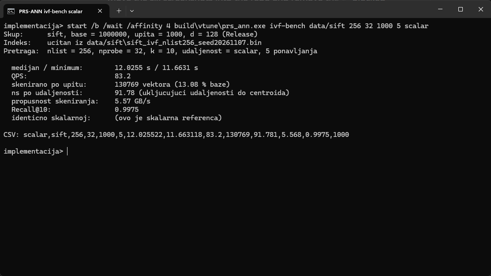
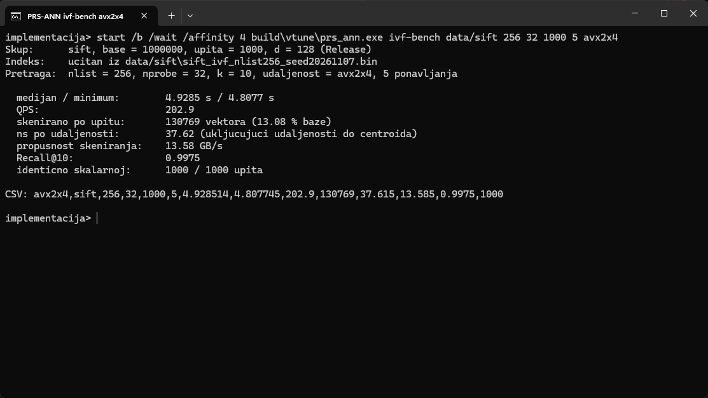
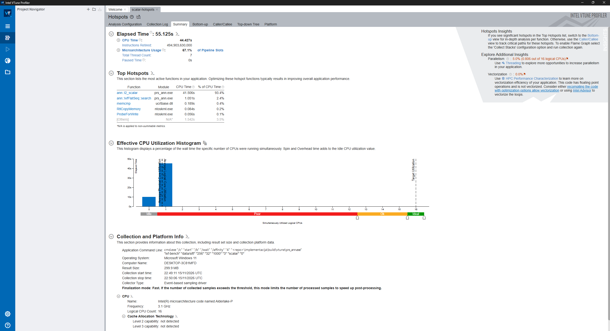
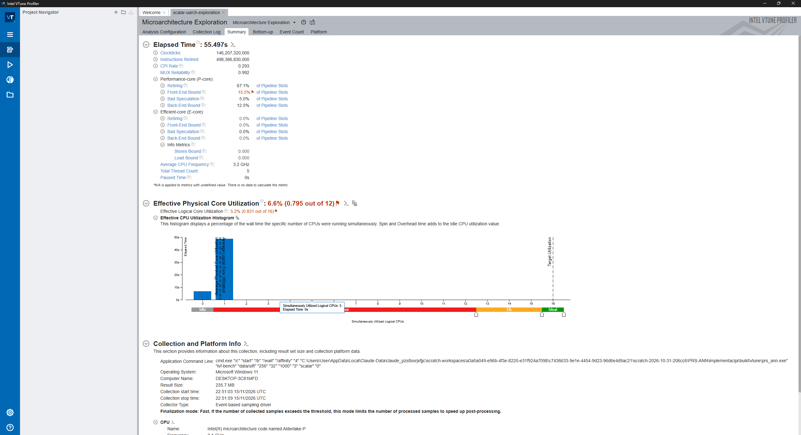
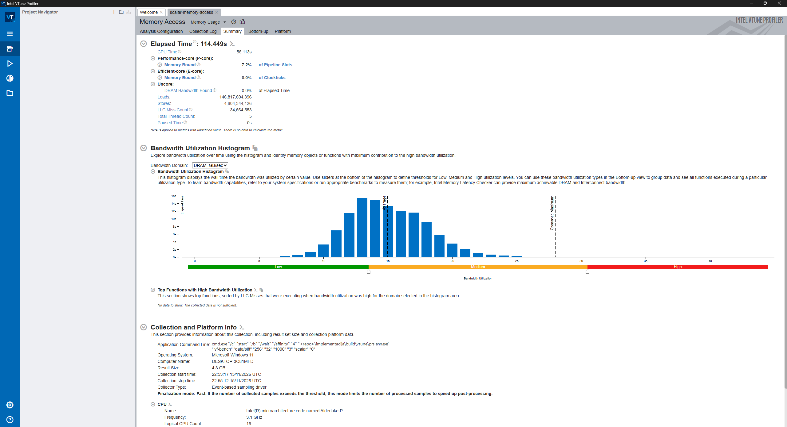
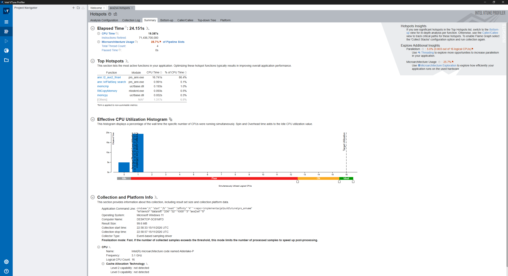
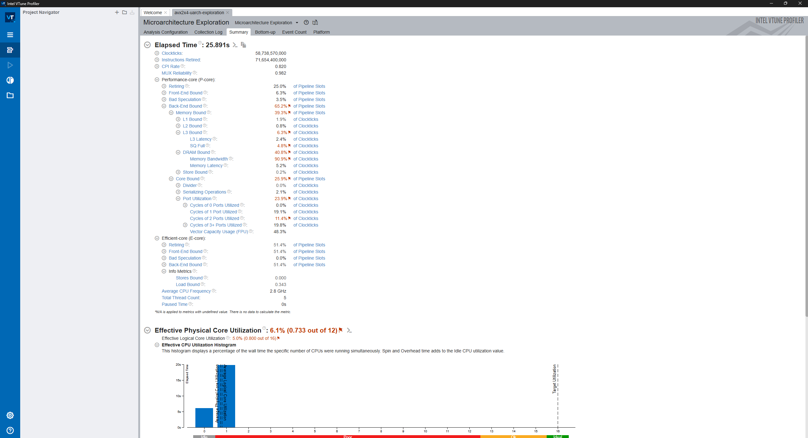

# VTune analiza i optimizacija pretrage IVF-Flat indeksa

Projekat PRS-ANN, 15.–16. 11. 2026. Mjereno Intel VTune Profilerom 2026.6 na Intel Core i5-12500H.

## Sažetak

- **Gdje je vrijeme:** 84–94 % CPU vremena pretrage troši jedna funkcija, kvadrat L2 udaljenosti (`l2_scalar`).
- **Čekamo li na keš i memoriju? Ne.** U početnoj verziji Memory Bound je ~6 % (DRAM 4 %), a program čita 5,7 GB/s.
- **Šta je usko grlo:**
  - **zavisnost podataka:** petlja traje tačno 2 takta po elementu, koliko jedno FP sabiranje koje čeka prethodno;
  - **skalarni kod:** FP Vector 0 %, 7 instrukcija po elementu.
- **SIMD faza (sve varijante daju identične rezultate):**
  - auto-vektorizacija 1,26×;
  - `omp simd` 2,12×;
  - ručni AVX2 + FMA sa 4 akumulatora **2,39×** na SIFT1M, a **6,06×** kad su podaci u kešu.
- **Novo usko grlo je memorija.** Na neopterećenom računaru VTune pokazuje porast:
  - Memory Bound sa 6,1 % na 41,9 %;
  - DRAM Bound sa 4,3 % na 43,6 %.

  Jedno jezgro dobija ~13,6 GB/s iz RAM-a, a ista funkcija iz keša čita 35 GB/s. Sljedeći korak je više jezgara (OpenMP).

## 1. Postavka

| | |
|---|---|
| Računar | Intel Core i5-12500H (Alder Lake: 4 P-jezgra + 8 E-jezgara, 16 niti), L2 9 MB, L3 18 MB, 16 GB RAM, Windows 11, na punjaču |
| Kompajler | GCC 13.2 (MSYS2 UCRT64), `-O3 -DNDEBUG -march=native -ffp-contract=off -g` |
| Skup | SIFT1M: 1.000.000 vektora, d = 128, liste 516 MB |
| Indeks | IVF-Flat, `nlist` = 256, napravljen jednom skalarnom verzijom i sačuvan; sva mjerenja učitavaju **isti** indeks |
| Pretraga | 1000 upita, `nprobe` = 32 (13,08 % baze, 130.769 vektora, ~64 MB po upitu), k = 10 |
| Vezivanje | proces vezan za logičko jezgro 2 (P-jezgro) preko `start /affinity`; na E-jezgru ista pretraga traje 2,3× duže |

Zašto ovi parametri: po upitu se skenira ~64 MB, više nego što staje u L3 keš (18 MB), pa analiza vidi stvarno ponašanje memorije. Indeks je sačuvan zato što bi brža funkcija udaljenosti pri izgradnji dala centroide različite u zadnjim bitima, pa "prije" i "poslije" ne bi bili isti indeks.

## 2. Metode

**Mjerenje vremena:** komanda `ivf-bench` mjeri samo pretragu (1 zagrijavanje, 5 ponavljanja, medijan; mjerni okvir iz Lab 1). Provjerava i da je rezultat, ID po ID i udaljenost po udaljenost, identičan skalarnoj referenci.

**VTune:** skripta `implementacija/scripts/vtune/collect.ps1` za svaku varijantu snima tri analize:

| Analiza | Šta pokazuje |
|---|---|
| Hotspots (hardversko uzorkovanje) | u kojoj funkciji je vrijeme |
| Microarchitecture Exploration | top-down podjela taktova procesora (vidi ispod) |
| Memory Access | koliko se čeka na L1/L2/L3/RAM i propusnost memorije |

Top-down metoda svrstava svako mjesto u cjelovodu procesora (4–6 po taktu) u jednu od četiri grupe:

| Grupa | Značenje |
|---|---|
| **Retiring** | koristan posao: instrukcija se izvršila do kraja |
| **Front-End Bound** | procesor ne stiže dohvatiti i dekodirati instrukcije |
| **Bad Speculation** | rad bačen zbog pogrešno predviđenog grananja |
| **Back-End Bound** | instrukcije čekaju: na memoriju (**Memory Bound**) ili na izvršne jedinice i rezultate prethodnih instrukcija (**Core Bound**) |

## 3. Početno stanje: šta je VTune pokazao

Funkcija `l2_scalar` (77 % CPU vremena), prvo snimanje (`rezultati/scalar-pocetno/`):

| Metrika | Vrijednost | Tumačenje |
|---|---|---|
| IPC | 3,54 | procesor je zauzet |
| Retiring | 69,3 % | većinom koristan posao... |
| — FP Scalar / FP Vector | 35,6 % / **0,0 %** | ...ali sav skalaran: SIMD se ne koristi |
| Vector Capacity Usage | 6,2 % | koristi se mali dio širine vektorskih jedinica |
| Memory Bound | **5,1 %** (DRAM 3,5 %) | ne čeka se na memoriju |
| Core Bound | 2,5 % | |
| Bad Speculation | 5,8 % | izlaz iz petlje od 128 iteracija, jednom po udaljenosti |
| taktova / instrukcija po elementu | **2,01 / 7,12** | |

Ponovljeno snimanje na neopterećenom računaru daje isto: 1,98 takta i 7,12 instrukcija po elementu, Memory Bound 6,1 % (sekcija 6).

Asembler petlje (7 instrukcija po elementu, tačno kao izmjereno):

```asm
loop:  vmovss  xmm0, [rcx+rax*4]          ; a[i]
       vsubss  xmm0, xmm0, [rdx+rax*4]    ; a[i] - b[i]
       add     rax, 1
       cmp     r8, rax
       vmulss  xmm0, xmm0, xmm0           ; razlika^2
       vaddss  xmm1, xmm1, xmm0           ; sum += ...  <- čeka prethodni sum
       jne     loop
```

**Tumačenje.** Svako `vaddss` čeka rezultat prethodnog kroz isti registar `xmm1`, pa petlja ne može biti brža od kašnjenja jednog FP sabiranja: izmjereno je tačno 2 takta po elementu. Za ta 2 takta procesor izvrši ostalih 6 instrukcija, pa VTune ovo vidi kao Retiring, a ne kao Core Bound: čekanje je skriveno iza korisnog posla.

Dva su uzroka sporosti:
1. **zavisnost podataka:** lanac sabiranja određuje tempo;
2. **skalarni kod:** 7 instrukcija za svaki element, iako AVX2 registar prima 8 floatova.

Skalarna verzija je namjerno kompajlirana bez vektorizacije, jer je referenca. Mjerenje pokazuje koliko taj izbor košta i odvaja dva uzroka.

Detalji i predviđanja zapisana prije optimizacije: [`nalazi-pocetno-stanje.md`](nalazi-pocetno-stanje.md).

## 4. Optimizacija: SIMD faza i eksperiment sa varijantama

Napravljeno je šest verzija iste funkcije; svaka mijenja jednu stvar:

| Varijanta | Kako nastaje SIMD | Akumulatora | Šta testira |
|---|---|---|---|
| `scalar` | bez vektorizacije (`-fno-tree-vectorize`) | 1 | početno stanje, referenca |
| `scalar4` | bez vektorizacije | 4 | samo uklanjanje zavisnosti |
| `auto` | kompajler sam (`-O3`, bez `-ffast-math`) | 1 | šta kompajler uradi bez pomoći |
| `omp` | `#pragma omp simd reduction(+:sum)` | 1 vektorski | vektorizacija uz dozvolu promjene redoslijeda sabiranja |
| `avx2` | ručno, AVX2 + FMA intrinzici | 1 vektorski | SIMD, lanac FMA ostaje |
| `avx2x4` | ručno, AVX2 + FMA intrinzici | 4 vektorska | SIMD + uklanjanje zavisnosti |

Jezgro `avx2x4` (`implementacija/src/distance/l2_avx2.cpp`): 32 elementa po koraku, četiri nezavisna lanca, 16 instrukcija na 32 elementa:

```cpp
for (; i + 32 <= d; i += 32)
{
    acc0 = fma_step(a + i, b + i, acc0);            // diff = a - b; acc += diff * diff
    acc1 = fma_step(a + i + 8, b + i + 8, acc1);
    acc2 = fma_step(a + i + 16, b + i + 16, acc2);
    acc3 = fma_step(a + i + 24, b + i + 24, acc3);
}
```

**Auto-vektorizacija:** izvještaj kompajlera (`-fopt-info-vec`) kaže "loop vectorized using 32 byte vectors", ali bez `-ffast-math` GCC ne smije promijeniti redoslijed float sabiranja. Zato radi in-order redukciju: razlike i kvadrate računa vektorski, a sabira ih i dalje jedno po jedno (15 skalarnih `vaddss` u asembleru). Lanac zavisnosti, dakle, ostaje. `#pragma omp simd reduction` eksplicitno dozvoljava sabiranje po trakama, pa tu nastaje pravi vektorski akumulator.

**Tačnost:** SIFT vrijednosti su cijeli brojevi 0–255, pa su sve međusume tačne u floatu (zbir < 2²⁴). Zato su udaljenosti bit-identične bez obzira na redoslijed sabiranja i FMA. To provjeravaju testovi (`test_distance_variants`, d od 1 do 130) i `ivf-bench` na svih 1000 upita.

## 5. Rezultati: vrijeme

SIFT1M (podaci iz RAM-a), samostalno mjerenje bez VTune-a:

| Varijanta | Vrijeme (1000 upita) | QPS | ns po udaljenosti | GB/s | Ubrzanje | Identično |
|---|---|---|---|---|---|---|
| `scalar` | 11,74 s | 85,2 | 89,6 | 5,7 | 1,00× | referenca |
| `scalar4` | 8,35 s | 119,8 | 63,7 | 8,0 | 1,41× | 1000/1000 |
| `auto` | 9,32 s | 107,3 | 71,2 | 7,2 | 1,26× | 1000/1000 |
| `omp` | 5,54 s | 180,6 | 42,3 | 12,1 | 2,12× | 1000/1000 |
| `avx2` | 5,11 s | 195,8 | 39,0 | 13,1 | 2,30× | 1000/1000 |
| `avx2x4` | 4,92 s | 203,4 | 37,5 | 13,6 | **2,39×** | 1000/1000 |

Kontrolni eksperiment, SIFT10K (indeks od 5 MB staje u L3 keš):

| Varijanta | ns po udaljenosti | GB/s | Ubrzanje |
|---|---|---|---|
| `scalar` | 87,1 | 5,8 | 1,00× |
| `scalar4` | 51,0 | 9,9 | 1,71× |
| `auto` | 58,8 | 8,6 | 1,48× |
| `omp` | 17,3 | 29,3 | 5,04× |
| `avx2` | 17,2 | 29,4 | 5,07× |
| `avx2x4` | 14,4 | 35,2 | **6,06×** |

Recall@10 je u svim varijantama isti: 0,9975 na SIFT1M, 1,0 na SIFT10K.

Šta se vidi:
1. **Auto-vektorizacija pomaže malo** (1,26×), jer lanac sabiranja ostaje.
2. **`omp simd` je praktično jednak ručnom AVX2 sa jednim akumulatorom** (17,3 naspram 17,2 ns u kešu). Direktiva je dovoljna da se dobije pravi SIMD.
3. **Četiri akumulatora** dodatno pomažu u kešu (+19 %), a iz RAM-a skoro ništa (+4 %), jer tamo granica više nije računanje (sekcija 7).

## 6. Rezultati: VTune poslije optimizacije

Ponovljeno snimanje na neopterećenom računaru, `scalar` naspram `avx2x4` (funkcija udaljenosti, P-jezgro; generiše `tabela.py`, sve u [`rezultati/tabele.md`](rezultati/tabele.md)):

| Metrika | `scalar` | `avx2x4` |
|---|---|---|
| instrukcija po elementu | 7,12 | **0,89** |
| taktova po elementu | 1,98 | **0,75** |
| CPI | 0,278 | 0,849 |
| Retiring % | 68,9 | 24,6 |
| — FP Scalar % | 36,4 | 0,7 |
| — FP Vector % | 0,0 | 37,9 |
| Vector Capacity Usage % | 6,2 | 48,2 |
| Front-End Bound % | 15,3 | 4,9 |
| Bad Speculation % | 6,0 | 1,3 |
| Back-End Bound % | 9,8 | 69,2 |
| — Memory Bound % | 6,1 | **41,9** |
| —— DRAM Bound % | 4,3 | **43,6** |
| — Core Bound % | 3,7 | 27,2 |
| udio CPU vremena funkcije udaljenosti % | 93,6 | 86,4 |

Šta se vidi:
1. **SIMD radi.** FP Vector raste sa 0 na 38 %, iskorištenost vektorskih jedinica sa 6 na 48 %, a broj instrukcija po elementu pada 8× (7,12 → 0,89).
2. **Usko grlo se pomjerilo na memoriju.** Memory Bound raste sa 6 % na 42 %, DRAM Bound na 44 %, a u VTune pregledu "Memory Bandwidth" čini 91 % DRAM Bound-a (snimak 07). Procesor sada veliki dio vremena čeka da podaci stignu iz RAM-a.
3. **Preostali Core Bound** (27 %) potiče od zauzetih portova za učitavanje i FMA, sabiranja traka na kraju i rada sa heapom.
4. **Zavisnost kod `avx2` (1 akumulator)** se vidi kao Core Bound 29 %, a `scalar4` smanjuje takte po elementu za ~30 %. Ove dvije varijante su snimljene u ranijem, opterećenom snimanju (`rezultati/scalar4/`, `rezultati/avx2/`), pa ih koristimo samo za smjer.

## 7. Novo usko grlo: propusnost memorije jednog jezgra

Zašto `avx2x4` nije 6× brža i na SIFT1M:
- **Na SIFT1M** obje AVX2 varijante i `omp` zapnu na 12–13,6 GB/s. Četiri akumulatora tamo donose samo 4 %, jer računanje više nije granica.
- **Na SIFT10K** (podaci u kešu) ista funkcija čita 35 GB/s, a četiri akumulatora donose ~19 %.
- **Računska procjena:** po elementu se rade oko 3 operacije na 4 bajta podataka (oduzimanje i FMA), tj. ~0,75 FLOP/B. Pri 13,6 GB/s to je ~10 GFLOP/s, a jedno jezgro sa dvije AVX2 FMA jedinice može ~100 GFLOP/s. Procesor bi, dakle, mogao računati ~10× brže nego što memorija dostavlja podatke.

Platforma ima ~45 GB/s, ali jedno jezgro može imati samo ograničen broj istovremenih zahtjeva prema memoriji. Propusnost je otprilike broj zahtjeva × 64 B / kašnjenje (Littleov zakon). Uz kašnjenje od ~100 ns, 13,6 GB/s odgovara ~20 istovremenih zahtjeva (procjena). Više jezgara znači više istovremenih zahtjeva, pa je **OpenMP faza** prirodan sljedeći korak za veće skupove.

## 8. Ograničenja mjerenja

- **Ponovljeno snimanje.** Prvo snimanje sve četiri varijante rađeno je dok su drugi programi opterećivali računar. `scalar` i `avx2x4` su zato ponovo snimljeni na neopterećenom računaru, i tabele u sekciji 6 su iz tog snimanja. Vremena programa tokom tog snimanja (11,9–13,6 s i 5,2–5,4 s) blizu su samostalnih (11,7 i 4,9 s); razlika je trošak samog VTune-a. VTune izvještaji za `scalar4` i `avx2` ostali su iz opterećenog snimanja.
- **Sistemska propusnost DRAM-a** u Memory Access analizi mjeri cijeli računar, uključujući i sam VTune: ~10 GB/s više nego što program čita. Zato se koriste metrike po funkciji i propusnost koju program sam izračuna (GB/s skeniranih vektora).
- **Inline funkcije:** sa `-g` VTune prikazuje AVX2 intrinzike (`_mm256_fmadd_ps`...) kao zasebne funkcije. Izvještaji po funkcijama zato se prave sa `-inline-mode off`, da se vrijeme pripiše funkciji udaljenosti.
- **Prvo Memory Access snimanje** je stalo na VTune-ovoj granici od 1000 MB. Kasnija snimanja su bez granice (`-data-limit 0`).
- **Granica od ~13,6 GB/s** je propusnost koju naš kod postiže na jednom jezgru; nije posebno potvrđena testom propusnosti memorije.
- **Jedno jezgro i jedna konfiguracija** (`nprobe` 32). Sa manjim `nprobe` više podataka staje u keš, pa bi ubrzanje bilo veće. Ponašanje sa više niti je tema OpenMP faze.

## 9. Zaključak

Početna verzija ne čeka na memoriju: ograničava je lanac zavisnih sabiranja (2 takta po elementu) i to što je sav posao skalaran.

SIMD faza je pokazala koliko koji pristup donosi:
- **kompajler sam (bez `-ffast-math`):** 1,26×, jer lanac ostaje;
- **`omp simd`:** 2,12×;
- **ručni AVX2 + FMA sa četiri akumulatora:** 2,39× na SIFT1M i 6× kad su podaci u kešu, uz 8× manje instrukcija po elementu i identične rezultate.

Nakon toga je usko grlo memorija: VTune na neopterećenom računaru pokazuje Memory Bound 42 % i DRAM Bound 44 %, a jedno jezgro ne povuče više od ~13,6 GB/s, dok ista funkcija iz keša čita 35 GB/s. Dalje ubrzanje zato ne dolazi od bržeg računanja, nego od manje bajtova po upitu ili od više jezgara.

**Mogući sljedeći koraci:**
- **OpenMP:** više jezgara znači više istovremenih zahtjeva prema memoriji.
- **Vektori kao `uint8`:** SIFT vrijednosti su 0–255, pa bi to bilo 4× manje bajtova uz tačne udaljenosti.
- **Grupisanje upita po listi:** jedna učitana lista služi više upita, pa se podaci više puta iskoriste.

## 10. Moguća pitanja

**Ako je zavisnost granica, zašto VTune kaže Retiring, a ne Core Bound?**
Lanac sabiranja traje 2 takta po elementu, a za to vrijeme procesor izvrši ostalih 6 instrukcija petlje. Portovi su zauzeti, pa top-down vidi koristan posao. Zavisnost se vidi u brojkama: tačno 2 takta po elementu, a uklanjanjem lanca (`scalar4`) takti padaju za ~30 %.

**Zašto auto-vektorizacija ne daje više?**
Bez `-ffast-math` kompajler mora sačuvati redoslijed sabiranja, pa vektorizuje samo oduzimanje i množenje, a sabira i dalje jedno po jedno. `omp simd reduction` mu eksplicitno dozvoljava drugačiji redoslijed i daje 2,12×.

**Zašto AVX2 nije 8× brže?**
Iz keša jeste blizu: 6,06×. Iz RAM-a ograničava propusnost memorije jednog jezgra (~13,6 GB/s); vidi sekciju 7.

**Zašto 4 akumulatora uz AVX2 donose samo 4 % na SIFT1M?**
Zato što računanje tamo više nije granica, nego memorija. U kešu ista promjena donosi ~19 %.

**Kako znate da je rezultat isti?**
`ivf-bench` poredi svih 1000 upita sa skalarnom referencom, ID po ID i udaljenost po udaljenost. Testovi provjeravaju sve varijante za d od 1 do 130. Za SIFT su udaljenosti tačne u floatu, pa poređenje može biti na tačnu jednakost.

**Zašto vezivanje za jedno jezgro?**
Procesor ima P i E jezgra; ista pretraga na E-jezgru traje 2,3× duže. Bez vezivanja vrijeme zavisi od toga gdje operativni sistem stavi program.

**Zašto je indeks sačuvan, a ne pravljen svaki put?**
Izgradnja na SIFT1M traje ~1,5 min, a brža udaljenost bi dala malo drugačije centroide. Ovako sve varijante mjere na bit-identičnom indeksu.

## 11. Snimci ekrana (dokaz pokretanja)

Snimci stvarnih pokretanja na ovom računaru (folder [`slike/`](slike/)). VTune snimci prikazuju početni pogled (Summary) ponovljenog snimanja na neopterećenom računaru. Taj pogled sažima cijelo snimanje, sa svim nitima, pa se brojke u njemu malo razlikuju od tabela po funkciji iz sekcije 6.

**Pretraga, samostalno pokretanje (vezano za P-jezgro):**


*Skalarna verzija: 12,03 s za 1000 upita, 83,2 QPS.*


*`avx2x4`: 4,93 s, 202,9 QPS, rezultat identičan skalarnoj referenci (1000/1000 upita).*

**VTune, skalarna verzija:**


*Hotspots: `ann::l2_scalar` troši 93,4 % CPU vremena; vidi se i komandna linija sa vezivanjem za jezgro (`start /affinity 4`).*


*Microarchitecture Exploration, P-jezgro: Retiring 67,1 %, Back-End Bound 12,5 % (Memory Bound 8,0 %, Core Bound 4,5 %), Vector Capacity Usage 6,2 %.*


*Memory Access, P-jezgro: Memory Bound 7,2 %, DRAM Bound 4,9 %.*

**VTune, `avx2x4`:**


*Hotspots za AVX2 verziju. Ovaj pogled prikazuje AVX2 intrinzike kao zasebne funkcije, pa `l2_avx2_fma4` nosi samo dio vremena (vidi sekciju 8).*


*Microarchitecture Exploration, P-jezgro: Back-End Bound 65,2 %, od toga Memory Bound 39,3 % (DRAM Bound 40,8 %, unutar njega Memory Bandwidth 90,9 %) i Core Bound 25,9 %; Vector Capacity Usage 48,3 %.*


*Memory Access, P-jezgro: Memory Bound 40,5 %, DRAM Bound 39,3 %.*

## Kako ponoviti

```bash
# iz implementacija/
./build/Release/prs_ann ivf-bench data/sift 256 32 1000 5 avx2x4      # vrijeme + provjera
powershell -ExecutionPolicy Bypass -File scripts/vtune/collect.ps1 -Distances scalar,avx2x4   # kao administrator
python scripts/vtune/tabela.py scalar avx2x4                          # tabele iz CSV-ova
```

Detaljno uputstvo je u `implementacija/README.md`, sekcija 12.

Fajlovi:
- **sirovi CSV izvještaji:** `rezultati/<varijanta>/` i `rezultati/scalar-pocetno/` (prvo snimanje);
- **vremena:** `rezultati/vremena-sift1m.txt` i `rezultati/vremena-sift10k-u-kesu.txt`;
- **asembler optimizovanih funkcija:** `rezultati/asembler-optimizovane.txt`.
